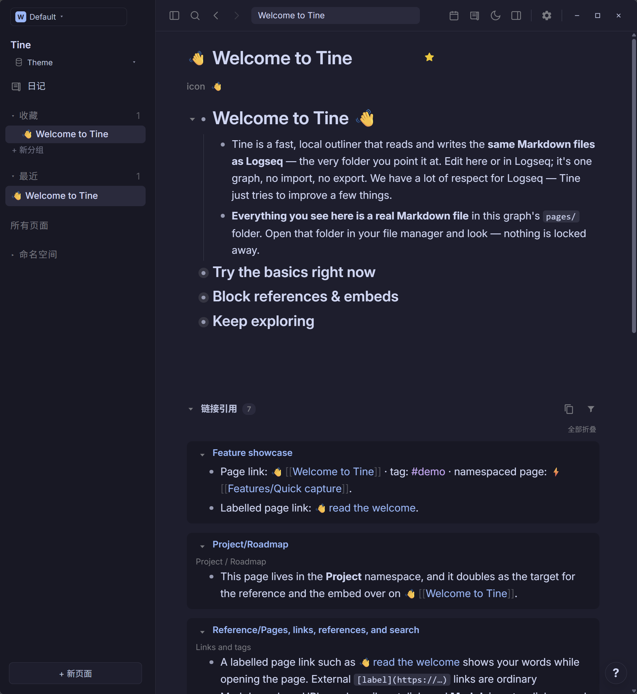
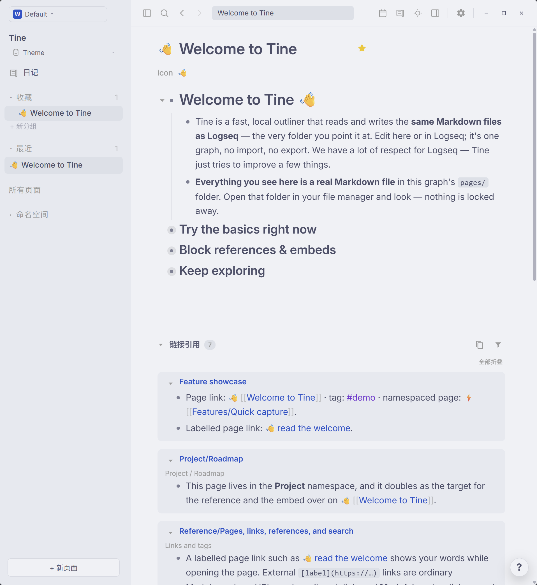

# Catppuccin · Prism

**Lavender rests in morning light; stars linger in the evening. Let each thought settle softly onto the page.**

[Download theme.json](https://github.com/EllisMorrow/tine-theme-catppuccin-prism/releases/latest/download/theme.json) · [中文说明](README.zh-CN.md) · [Adaptation notes](docs/adaptation.md)

Latte and Mocha meet in a single Prism theme: a pale morning page and a deep blue evening, joined by lavender accents, blue links and a trace of golden warmth.

### Dark mode

### Light mode

*Actual Windows Tine screenshots supplied after testing. Both palettes are included in this package.*

## Install

1. Download [theme.json](https://github.com/EllisMorrow/tine-theme-catppuccin-prism/releases/latest/download/theme.json).
2. In Tine, open **Settings → Appearance → Theme packages → Select theme.json** and select the downloaded file.
3. Choose **Use colors**, then select **Light**, **Dark** or **System** mode.

Requires Tine Theme API **0.2** support. Existing `logseq/custom.css` and device accent settings may affect the result. This package supplies colors only; typography, layout, task markers and other roles outside the theme API remain host-controlled.

## Palette

| Role | Light | Dark |
| --- | --- | --- |
| Canvas | `#eff1f5` | `#1e1e2e` |
| Sidebar | `#e6e9ef` | `#181825` |
| Body | `#4c4f69` | `#cdd6f4` |
| Heading | `#4c4f69` | `#cdd6f4` |
| Accent | `#8839ef` | `#cba6f7` |
| Links | `#1852c8` | `#8eb7fa` |
| Tags | `#7632d0` | `#cba6f7` |
| Mark background | `#ecddca` | `#4a4548` |

## Tested in Tine

The manifest passed the official theme checker. A Chromium fixture checked both complete token sets, mode switching and specified contrast pairs. The user supplied the real Windows light/dark screenshots above using Tine's public welcome graph. The visible headings, body, outlines, links, tags, inline code and reference panels are shown; mark highlights, selection behavior, Settings and other platforms are not established by these images. See [screenshot notes](docs/screenshots.md).

## Source and scope

Based on [Catppuccin Latte / Mocha](https://github.com/catppuccin/palette) at `07d02aa110ef9eb7e7427afca5c73ba9cf7f8ebd`, under MIT; see [LICENSE](LICENSE). Both modes are based on the official open-source Catppuccin Latte and Mocha palettes, the pair referenced by Codex. They are independently mapped to Tine semantic roles; selected surface and text adjustments are documented below.

Independent community adaptation by **EllisMorrow**, developed with AI assistance (`aiDevelopment: primary`). No Codex program code, logo or bundled assets are included. No affiliation or endorsement is claimed.

Only the 21 supported literal color roles per mode are packaged. It does not claim pixel-for-pixel reproduction of Codex, or that all Tine-derived and opacity-dimmed text meets a contrast target. Check results and actual application coverage are recorded in [adaptation notes](docs/adaptation.md).

## Feedback

[Open an issue](https://github.com/EllisMorrow/tine-theme-catppuccin-prism/issues) with your Tine version, operating system, mode and a screenshot without private note content. The download badge counts GitHub Release asset downloads, not installations or unique users.
